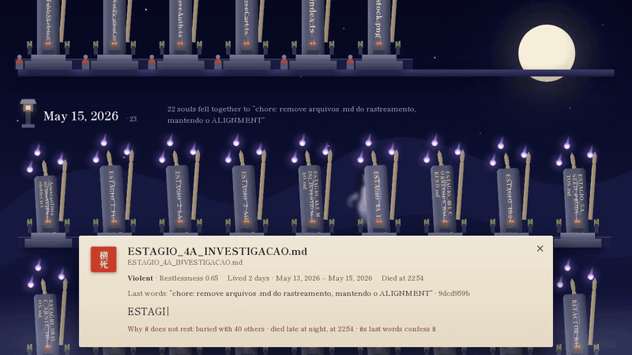

<p align="center">
  
</p>

<p align="center">
  <b>English</b> · <a href="README.pt-BR.md">Português</a>
</p>

<p align="center">
  
  
  
  
  
  
</p>

---

In Japan, *kuyō* (供養) is a memorial service for objects that served well: needles, dolls, brushes, even eyeglasses. They are thanked and laid to rest instead of just thrown away.

**Kuyō does the same for source code.** It reads a repository's git history, finds every file that was deleted, and holds a funeral for each one: how it lived, how it died, and how restless its soul is. A local open-weight model writes the epitaphs, and the result is a cemetery in a single HTML page, where restless souls haunt their graves.

> 🔒 **Your code never leaves your machine.** Everything runs offline, with a model you control.

Built for the DEV Hacktoberfest 2026 challenge, week 4: *Ghost in the Machine*.

<p align="center">
  
</p>

<p align="center"><a href="https://mauricioandrade.github.io/kuyo/cemetery.html"><b>Walk the cemetery yourself →</b></a></p>

> The demo cemetery comes from **stocklentes-hub, a private repository of mine**: 137 deleted files over five months. Its code stays private; only file names, dates, commit messages and the epitaphs Gemma wrote for them appear here. That is the point of Kuyō: the code never left my machine to produce this page.

## 🪦 Commands

| Command | What it does | State |
|---|---|---|
| `kuyo scan <repo>` | Lists the dead and their cause of death, no LLM | ✅ working |
| `kuyo bury <repo> [-o out]` | Writes epitaphs with Gemma and renders the cemetery | ✅ working |
| `kuyo seance <repo> <file>` | Talk to a dead file | ✅ working |
| `kuyo haunt` | Possesses your shell: deleted files whisper back | ✅ working |

## 🚀 Getting started

**Requirements**

- ☕ Java 25 (the repo pins it with [mise](https://mise.jdx.dev): `mise install`)
- 🦙 For `bury`: [Ollama](https://ollama.com) with a Gemma model, e.g. `ollama pull gemma4:e4b`

**Run**

```bash
./mvnw package
java -jar target/quarkus-app/quarkus-run.jar scan path/to/repo
```

| Option | Effect |
|---|---|
| `--order restlessness` | sort by restlessness instead of chronologically |
| `--findings` | print every factor behind the restlessness score |

```
✝ src/lib/rate-limit.ts  [VIOLENT · 0.66]
    2026-06-05 02:14 → 2026-06-12 01:55 -03:00  (6 days, 1 commits, 16 lines)
    authors: mauricioandrade
    killed in 135a99b3 by mauricioandrade: "fix: limite de tamanho nos inputs de palpites e awards; remove rate-limit em memoria"
    commit: 3 files, -18 lines, without tests
    findings: size 0.39 · hour 1.00 · message 1.00 · no tests 1.00 · short life 0.22
```

Deleted at 1:55 a.m., in a commit whose message says `remove`, with no tests. A violent death.

### 🕯️ Burying

```bash
java -jar target/quarkus-app/quarkus-run.jar bury path/to/repo -o cemetery.html
```

Gemma writes one epitaph per soul, about a second each on my machine, and Kuyō renders a single self-contained `cemetery.html`: a night walk through a Japanese cemetery, one terrace per month (or per day, when a month holds too many deaths). Pillar height is the file's lifespan, the flames are its restlessness, violent graves lean and raise a yūrei, forgotten ones grow moss. Approach a grave to read its epitaph.

<p align="center"></p>

> Here rests SpikeResource.java, a brief experiment that lasted but nine hours. It met its end with the decree, "chore(web): remove phase 2 spike endpoint." May its ephemeral existence find quiet in the void.

| Option | Effect |
|---|---|
| `--lang en\|pt` | language of the epitaphs (default `en`) |
| `--no-epitaphs` | render the cemetery without calling the model |
| `--autopsy` | ask the Shishō to examine every dead Java file (see below) |

Epitaphs are cached in a `kuyo.json` next to the output, keyed by death commit, language and model, so reruns are instant. The model is configured at runtime, no rebuild needed:

| Environment variable | Default |
|---|---|
| `KUYO_MODEL` | `gemma4:e4b` |
| `KUYO_OLLAMA_URL` | `http://localhost:11434` |
| `KUYO_SHISHO` | `shisho` (a command on the `PATH`, or the path to a `shisho.jar`) |

### 師 Autopsy

With `--autopsy`, every dead Java file goes on the table of [Shishō](https://github.com/mauricioandrade/shisho), my Java code reviewer. Kuyō writes the file's last contents to a temporary folder next to the `pom.xml` or `build.gradle` it lived with, runs `shisho analyze` on it, and carves on the grave only the lessons found in the dead file itself:

> 師 **The Shishō's autopsy:** medium · No centralized error handling (line 21)

When the Shishō finds nothing, the washi says so: *it died clean*. Like the restlessness score, the autopsy is deterministic. No model is involved.

### 🕯️ Séance

```bash
java -jar target/quarkus-app/quarkus-run.jar seance path/to/repo EmailService.java
```

The file's ghost answers in first person. It remembers its last contents and the facts of its life and death, and nothing else:

```
> What did you do when you were alive? Be specific.
EmailService.java: My primary function was to send status change notifications via email.
I held a method, `enviarMudancaStatus`, which asynchronously dispatched messages detailing
updates to a specific order's status. I used a `JavaMailSender` to accomplish this task.

> Who was the president of Brazil when you died?
EmailService.java: The dead do not know such things.
```

<p align="center"></p>

Pass a full path or just the file name. `--lang pt` makes the ghost speak Portuguese, `-q "question"` asks without opening the interactive session, and `/bye` lets the spirit rest.

### 霊 Haunting

```bash
java -jar target/quarkus-app/quarkus-run.jar haunt >> ~/.bashrc   # or ~/.zshrc
```

Run it with Java 25 (`java -version`): the hook records the absolute path of the `java` that printed it.

This possesses your shell. From then on, when you delete a tracked file the file whispers back a few seconds later, in first person, written by Gemma from the facts of its life:

```
$ rm src/EmailService.java
$
  霊 I am EmailService.java. I lived 27 days, through 2 commits, and I'm still here, in HEAD. For now.
     there is still time: git restore -SW -- ':/src/EmailService.java'
```

Before the commit, the file is examined as if it died right now, with your command as its last words, so it already knows how it will die. After `git commit`, the souls that commit took speak once, already dead. Other ways of losing work get a fixed line: `git reset --hard`, `git clean -f`, `git push --force`, `git branch -D`, `git stash drop` and `git checkout -- .`. Every other command gets silence.

The hook is a few lines of shell that you can read in your rc file. It only calls Kuyō for commands that might kill something, and runs it in the background so your prompt comes back right away. `--no-monk` uses fixed lines instead of the model, `--lang pt` whispers in Portuguese, and `NO_COLOR` is respected.

### 🤖 GitHub Action

Kuyō is also a GitHub Action. This workflow buries your repository on every push to `main` and publishes the cemetery on GitHub Pages (set *Settings → Pages → Source* to *GitHub Actions*):

```yaml
name: Cemetery
on:
  push:
    branches: [main]
permissions:
  contents: read
  pages: write
  id-token: write
jobs:
  bury:
    runs-on: ubuntu-latest
    environment:
      name: github-pages
    steps:
      - uses: actions/checkout@v4
        with:
          fetch-depth: 0
      - uses: mauricioandrade/kuyo@main
        with:
          output: _site/index.html
      - uses: actions/upload-pages-artifact@v3
        with:
          path: _site
      - uses: actions/deploy-pages@v4
```

| Input | Default | Effect |
|---|---|---|
| `path` | `.` | repository to bury |
| `output` | `cemetery.html` | where to write the cemetery |
| `lang` | `en` | `en` or `pt` |
| `model` | `gemma4:e4b` | Ollama model for the epitaphs |
| `epitaphs` | `true` | `false` skips the model, and Ollama is never installed |
| `autopsy` | `false` | `true` downloads the [Shishō](https://github.com/mauricioandrade/shisho) and examines every dead Java file |

When there is something to bury, the action installs Ollama on the runner and pulls the model, so the code still never leaves infrastructure you chose. Epitaphs are cached between runs, so only new deaths call the model. The model runs on the runner's CPU, so the first burial of a large history takes a while.

Kuyō buries itself this way: [its own cemetery](https://mauricioandrade.github.io/kuyo/self/) is rebuilt on every push. Nothing has died here yet.

## 🔍 How a death is investigated

### ⛏️ Exhumation

Kuyō reads history with [JGit](https://www.eclipse.org/jgit/), in pure Java, without calling the `git` binary. It walks the first-parent history from the oldest commit to the newest:

- **Renames and moves are not deaths.** The file's life continues under its new path, using the same 50% similarity threshold as `git` itself.
- **Resurrections count as new lives.** A file deleted and later recreated at the same path dies twice.
- **A merge is one event.** The same deletion is never counted twice, and files that died on branches never merged are left alone.
- **OS junk gets no funeral** (`*:Zone.Identifier`, `.DS_Store`, `Thumbs.db`).

<p align="center"></p>

### 👻 Restlessness

Restlessness is a score from 0 to 1, computed deterministically in Java. The model only ever receives the result, never decides it: the facts are Java's, the words are Gemma's.

| Factor | Weight | Rule |
|---|---|---|
| 📦 Size of the death commit | 0.30 | log scale, maxes out at 50 files or 2,000 lines removed |
| 🌙 Hour of death | 0.15 | midnight to 5 a.m. in the author's own timezone; 10 p.m. to midnight counts half |
| 💬 Commit message | 0.20 | empty, or contains `remove`, `delete`, `wip`, `hotfix`, `cleanup`, `oops` (and Portuguese equivalents) |
| 🧪 No tests | 0.15 | source file deleted in a commit that touched no tests |
| ⏳ Short life | 0.20 | log scale in hours: one hour ≈ 0.9, one day ≈ 0.5, zero at 30 days |

The weights were calibrated against 175 real deaths across nine of my own repositories. The first draft used linear scales, which saturated almost immediately: in practice files die young and in mass graves.

<p align="center"></p>

### ⚰️ Cause of death

Checked in this order:

1. ⚔️ **VIOLENT**: restlessness ≥ 0.6
2. 🥀 **PREMATURE**: lived less than a day
3. 🕸️ **FORGOTTEN**: untouched for more than a year before deletion
4. 🕯️ **NATURAL**: everything else

<p align="center"></p>

`.gitkeep` files always die of natural causes. They exist to be replaced by real code, so their mission was accomplished.

## 🌱 Why local and open

Proprietary code can't be sent to a closed API. Kuyō runs entirely on your machine, costs nothing per run, works offline, and the model is just a configuration value you can swap.

## 🧰 Stack

Java 25 · Quarkus (picocli) · JGit · LangChain4j + Ollama · Gemma · Qute

The cemetery and the banner are drawn by hand in SVG and CSS, with no downloaded images. The reaction GIFs in this README are not mine.

The cemetery uses [Shippori Mincho B1](https://github.com/fontdasu/ShipporiMincho) by the Shippori Mincho Project Authors, under the [SIL Open Font License](src/main/resources/fonts/OFL.txt), embedded as small subsets so the page stays a single offline file.

## 📜 License

[MIT](LICENSE)
